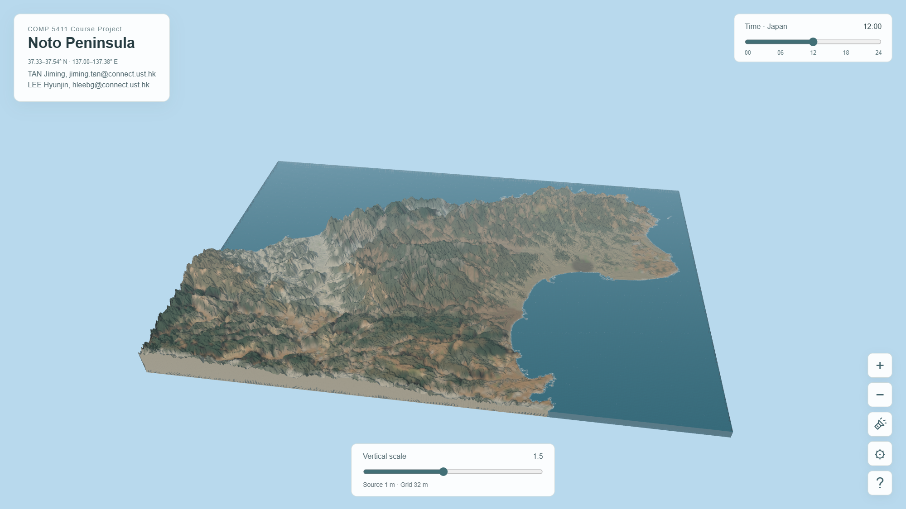
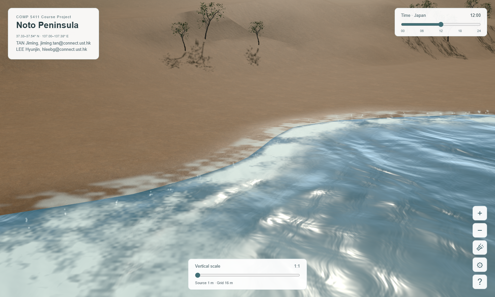
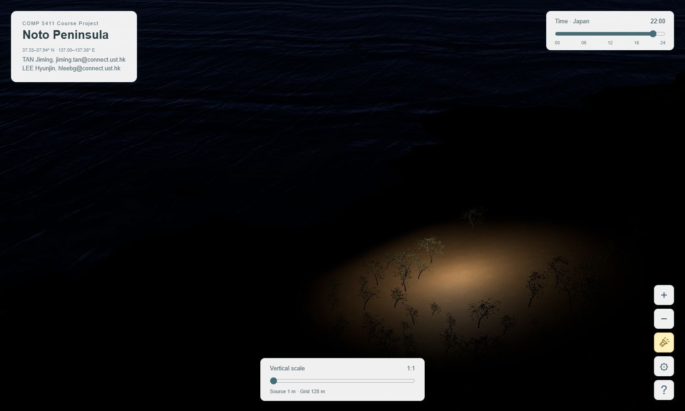

# Noto Peninsula: An Interactive 3D Landscape

## Project Progress Report

**Course**: HKUST COMP5411, Fall 2026\
**Group**: 12 — LEE Hyunjin and TAN Jiming\
**Progress as of**: October 18, 2026\
**Progress video deadline**: Sunday, October 25, 2026, at 23:59

> This report provides the written basis for the progress presentation. The required submission remains one `progress.mp4` per group, lasting between 3 minutes 30 seconds and 4 minutes. This document is not a verbatim narration script.

> Snapshot scope: this report preserves the implementation and measurements as of October 18, 2026. The current viewer also includes the October 19 soil-grass and local distance-adaptive terrain updates. See [CODE_GUIDE.md](../CODE_GUIDE.md) for the current architecture; the uniform-visible-LOD descriptions below refer to the dated report baseline.

## 1. Project overview and progress summary

Our project combines real elevation, geological categories, and vegetation distribution with real-time graphics to create an interactive browser-based landscape of the Noto Peninsula. Users can move from a regional overview to mountains, vegetation, and coastal scenes, using camera controls and date, time, and weather settings to explore their appearance.

The selected region covers approximately **33.23 × 23.14 km**, within **37.33–37.54° N and 137.00–137.38° E**. Terrain is based on a 1 m DEM from the Geospatial Information Authority of Japan. Geological rendering categories draw on Geological Survey of Japan maps and the borehole records used by the project. Vegetation distribution uses the University of Tsukuba's approximately 10 m land-cover classification for 2024. Plant models are illustrative, rather than surveyed individual trees. The model base at 100 m below sea level is a visualization boundary, not measured bathymetry.[1][10]

The integrated Three.js / WebGL2 prototype now contains the principal functions planned for proposal Weeks 4–9: blended terrain materials, instanced vegetation, animated water, sunlight and weather, shadows, and adaptive detail. Targeted geometry, animation, and interaction checks have been completed. Comprehensive integration testing, evaluation across devices, and final presentation materials remain under Week 10. Week numbers follow the proposal; functional integration does not imply completion of all acceptance testing.[1]

The main programming achievements are:

- Organizing the large DEM into asynchronously loaded terrain tiles, with a continuous coastline shared across detail settings.
- Integrating geological categories, triplanar projection, and continuous material blending through custom GLSL, addressing steep-slope stretching, repetition, and distant texture aliasing.
- Coordinating wave displacement, normals, foam, spray, vegetation wind, and rain through a shared animation clock.
- Adapting detail to the view and measured rendering load, and pausing rendering and animation after a default 30 seconds without interaction.

## 2. Current prototype and demonstration

The application entry point is `index-1m.html`. The initial highest-detail setting is 5 m; the active mesh also depends on the view and performance budget. A 1 m source dataset does not mean that the entire region is continuously rendered at 1 m spacing.



*Figure 1. Regional overview of the development prototype, showing terrain, geological and vegetation appearance, water, and interactive controls. This capture uses fivefold vertical exaggeration; the status indicator reports an active 32 m grid.*

The demonstration will connect visible results to their implementation. It starts with ridges, valleys, and the coastline at regional scale, then approaches the surface to show material transitions and varied tree forms. A continuous coastal shot demonstrates moving geometry, advancing foam, and recession. Time and weather controls then show changing illumination, followed by the nighttime pointer light and detail settings.



*Figure 2. An actual development capture of nearshore water, foam, ground materials, and vegetation. A still image records one animation state; the video must show the motion continuously.*



*Figure 3. Nighttime local illumination. The enabled flashlight follows the terrain position under the pointer. All three figures are actual development-test captures from October 18, 2026, rather than concept images.*

### 2.1 Project file structure (relative paths)

The directory containing `index-1m.html` is `./`. This selection shows the principal runtime and rebuilding files; repeated tiles and individual assets are omitted.

```text
./
├── index-1m.html
├── src/
│   ├── terrain.js
│   ├── tile-geometry.js
│   ├── coastal-geometry.js
│   ├── model-volume.js
│   ├── material-textures.js
│   ├── rock-materials.js
│   ├── water-materials.js
│   ├── water-motion.js
│   ├── vegetation.js
│   ├── environment.js
│   ├── scene-effects.js
│   └── styles.css
├── data/
│   ├── terrain-1m/manifest.js
│   ├── terrain-1m/L0/ ... L7/
│   ├── strata-data.js
│   ├── material-texture-config.js
│   ├── vegetation-data.js
│   └── shoreline-data.js
├── assets/
│   ├── material-library/
│   └── vegetation/
├── gis/vegetation/
├── noto_terrain_materials_package/
├── scripts/
│   ├── build_native_tiles.py
│   ├── build_coastline_field.py
│   ├── build_runtime_materials.py
│   ├── build_vegetation_assets.py
│   └── serve.py
└── vendor/
```

| Relative path | Contents and reading focus |
| --- | --- |
| `./index-1m.html`, `./src/styles.css` | Controls, script loading order, and interface styling |
| `./src/terrain.js` | Scene orchestration, camera, tile requests, caching, LOD, and frame scheduling |
| `./src/tile-geometry.js`, `./src/coastal-geometry.js`, `./src/model-volume.js` | Terrain triangles, continuous coastline, walls, and bottom |
| `./src/rock-materials.js`, `./src/material-textures.js` | Geological shading, texture resources, and filtering |
| `./src/water-*.js`, `./src/vegetation.js`, `./src/environment.js`, `./src/scene-effects.js` | Water, plants, sunlight/weather, pointer lighting, and spray |
| `./data/` | Generated runtime data loaded by the browser; normally not edited by hand |
| `./assets/`, `./gis/vegetation/` | Source/derived material and plant assets, vegetation rasters, and satellite reference imagery |
| `./noto_terrain_materials_package/` | Geological maps, borehole summaries, and the reference model |
| `./scripts/`, `./vendor/` | Offline generation and local serving; third-party libraries |

The English distribution also contains `./README.md`, `./CODE_GUIDE.md`, and `./REBUILD.md`. This report is stored as `./docs/COMP5411_Progress_Report_EN.md`, with the original DEM under `./source-data/terrain/`. The development project and English distribution share the runtime paths shown above; their documentation directories differ.

Read `index-1m.html → src/terrain.js → geometry modules → material/animation modules`. Offline scripts derive `data/` and runtime assets from sources; the browser does not reread and process the original TIFF every frame.

## 3. Completed programming work

The short excerpts below come from the current implementation and omit surrounding context. They explain the mechanisms rather than form standalone programs.

### 3.1 Geometry processing: tiled terrain and a continuous coast

Offline scripts convert source elevation data into multiple tile levels. At runtime, `tile-geometry.js` constructs vertex positions, triangle indices, and normals; `model-volume.js` supplies outer walls and a bottom surface. Vertical exaggeration affects the display transformation without overwriting the source DEM. Normal transformation must account for this nonuniform scaling to preserve correct lighting directions.

Deleting triangles along a coarse land/water mask produces increasingly large steps at lower resolutions. Instead, `coastal-geometry.js` uses the zero contour of a shared continuous shoreline-distance field, intersects triangles with that contour, and refines the boundary locally. Land and water use the same intersection convention, avoiding gaps between independently generated boundaries. Local coastal refinement preserves the shoreline when the regional base grid becomes coarse.

The displayed coast derives from a smoothed field on an approximately 8 m grid, not a centimetre-accuracy shoreline survey. A 64 m coastal display profile also maintains contact with mean sea level: the inner 16 m is flattened toward sea level, followed by a smooth transition to the original displayed elevation. This intentionally changes the local displayed shore slope and must not be used for terrain measurement or coastal engineering analysis.

Implementation excerpt: `clip()` in `src/coastal-geometry.js`. The fourth vertex component is signed shoreline distance. An edge whose endpoints lie on opposite sides receives a shared intersection.

```javascript
for (let i = 0; i < points.length; i++) {
  const a = points[i],
    b = points[(i + 1) % points.length];
  const ai = sea ? a[3] >= 0 : a[3] <= 0,
    bi = sea ? b[3] >= 0 : b[3] <= 0;
  if (ai) output.push(a);
  if (ai !== bi) output.push(crossing(a, b));
}
```

### 3.2 Materials and shading

`rock-materials.js` maps 27 land-based geological rendering categories to separate textures or composite recipes, using color, normal, and roughness information. Triplanar projection blends three projection directions according to surface orientation, giving steep slopes and exposed side faces more appropriate texture coverage than a single overhead projection.

Material boundaries blend attributes and weights, rather than interpolating category identifiers. A 3 × 3 × 3 neighborhood in the classification field supplies smooth weights. Repeated categories are combined before sampling, and homogeneous regions use a cheaper path. The approximately 150 m horizontal classification spacing and visual blending widths must not be interpreted as 1 m geological accuracy.

Deterministic texture rotations, offsets, and continuous blending reduce regular repetition. `material-textures.js` provides mipmaps and anisotropic filtering. Gradients are calculated outside category-dependent branches and supplied explicitly to texture sampling, improving minification at distant and grazing views. Normal-map orientation follows the same projection rotations. Vegetation ground cover fades out over bare ground and steep slopes to expose the corresponding geological material. Shadow-induced striping is handled separately through shadow-depth bias, rather than being treated as a texture-filtering problem.

Implementation excerpt: `notoTextureSample()` in `src/rock-materials.js`. Continuous noise blends two randomized samples; `notoTextureTap()` performs the rotated, offset lookup with explicit gradients.

```glsl
float k=notoNoise(uv*0.09+float(layer)*3.7)*7.0;
float cell=floor(k), blend=smoothstep(0.15,0.85,fract(k));
return mix(notoTextureTap(textureSampler,uv,layer,dx,dy,cell,detail),
           notoTextureTap(textureSampler,uv,layer,dx,dy,cell+1.0,detail),blend);
```

### 3.3 Vegetation: stable placement and instancing

`vegetation.js` determines suitable areas from land-cover classes and uses a fixed spatial grid with deterministic seeds for placement. Zooming changes the representation of existing plants instead of generating a new random forest. Excluded classes include urban areas, water, and bare ground; buildings are outside the reconstruction scope.

`THREE.InstancedMesh` batches repeated geometry to reduce draw calls. Near and middle distances use different mesh detail, while distant trees use simplified cards and fade out over approximately 1200–1500 m. Four broadleaf and four conifer shape variants, together with size and orientation variation, reduce identical repetition. Nearby vegetation receives subtle vertex-based wind animation. Placement remains spatially stable, but the number actually drawn still depends on frustum culling, distance fading, and rendering budgets.

Implementation excerpt: placement in `src/vegetation.js`. A fixed grid seed chooses the shape, `level` selects geometry detail, and `addInstance()` writes the instance matrix. Zooming does not randomly choose a new shape.

```javascript
const library = libraries.get(point.key);
const variant = Math.floor(seedAt(point.i, point.j, 2) * library.variants);
point.variant = variant;
const s = point.plantHeight / library.variantDimensions[variant].y;
addInstance(point, level, variant, s, s, s);
```

### 3.4 Water and surf animation

`water-motion.js` combines three Gerstner components in the vertex shader, with base wavelengths of 512, 192, and 72 m. Each has a direction, amplitude, and initial phase:

$$
\phi_i = k_i\mathbf d_i\cdot\mathbf p-\omega_i t+\phi_{i,0},
\qquad k_i=2\pi/\lambda_i,\qquad \omega_i^2=gk_i.
$$

Displacement includes horizontal orbital motion and vertical movement. Surface normals come from spatial differences of the same complete displacement function, keeping highlights consistent with wave geometry. Tiles share coordinates and time. Grid-dependent filtering attenuates wavelengths that coarse geometry cannot adequately sample; smaller ripples remain in normal textures. Wave amplitude is independent of terrain exaggeration.

The shoreline-distance field drives nearshore crests, advancing and receding foam, and a wet band on land. `scene-effects.js` adds a bounded set of local GPU spray particles. The mean contact position stays fixed and wave amplitude is controlled near shore. These are parameterized visual effects, not a fluid simulation of breaking waves, bathymetry-dependent shallow-water propagation, or erosion. Full scene reflection and refraction are also not implemented.

Implementation excerpt: the wave-component loop in `seaOffset()`, `src/water-motion.js`. Each `w` holds direction, wavelength, amplitude, and initial phase. The grid-dependent `smoothstep` suppresses undersampled short waves.

```glsl
vec4 w = uSeaWaves[i];
vec2 d = vec2(cos(w.x), sin(w.x));
float k = 6.28318530718 / w.y;
float phase = k * dot(d, p) - sqrt(9.81*k) * uSeaTime + w.w;
float a = w.z * uSeaWeather * fade * smoothstep(1.5*uSeaGrid, 4.0*uSeaGrid, w.y);
offset += a * vec3(0.55*d.x*cos(phase), sin(phase), 0.55*d.y*cos(phase));
```

### 3.5 Sunlight, weather, and interactive lighting

`environment.js` estimates solar direction from the selected date and GMT+9 time. It controls day/night illumination, sky color, and clear, cloudy, and rainy presets. Sunlight uses a directional light and Three.js shadow mapping; rain advances on the GPU using the shared clock. The upper-right slider controls time directly, while date and weather remain in settings.

The nighttime flashlight is an interactive point light. A camera ray is generated from the pointer, intersected with the height field, and refined to position the light. This avoids traversing every terrain triangle on each pointer update. The feature combines camera rays, geometric intersection, and light attenuation while making local materials visible during a nighttime demonstration.

Implementation excerpt: pointer-light update in `src/scene-effects.js`. After the height-field intersection produces `hit`, the light is placed above that point and its range is adjusted to viewing distance.

```javascript
radius = THREE.MathUtils.clamp(camera.position.distanceTo(hit) * 0.12, 24, 360);
light.position.copy(hit).add(new THREE.Vector3(0, radius * 0.7, 0));
light.distance = radius * 2.6;
light.intensity = radius * radius * 2.4;
```

### 3.6 Adaptive detail, caching, and rendering control

`terrain.js` coordinates loading, camera interaction, detail selection, and rendering. Available coarse layers and resident data provide coverage while finer geometry loads asynchronously. Frustum culling and caches reduce unnecessary work. Terrain detail, canvas pixel resolution, and vegetation detail have separate controls because they affect different costs.

The current implementation uses a uniform base LOD for visible terrain, with additional coastal refinement. It follows chunked-LOD principles but is not a complete per-tile, distance-adaptive CDLOD implementation. Budget feedback uses consecutive frame intervals and, where supported, asynchronous GPU timing. This prevents a short JavaScript submission time from being mistaken for inexpensive GPU work. Sustained slow frames can reduce mesh and automatic canvas budgets.

Water, vegetation, rain, and spray share one clock. By default, animation continues for 30 seconds after the last interaction, then frame requests and animation time stop. A hidden page also pauses; new interaction wakes the scene. Loaded resources remain cached, so sleeping does not mean releasing all GPU memory.

Implementation excerpt: `requestRender()` in `src/terrain.js`, with its comment omitted and a line wrapped. `framePending` permits only one outstanding frame. Animation requests pass `false`; the caller uses `stayAwake()` to enforce sleep.

```javascript
function requestRender(updateScene = true) {
  sceneUpdatePending ||= updateScene;
  if (framePending === null && !document.hidden)
    framePending = requestAnimationFrame(render);
}
```

## 4. Connections to COMP5411 material

The following mapping uses the supplied course slides. It identifies conceptual connections without assuming that every listed chapter had already been taught by the report date.[2–9]

| Course topic and slide numbers | Project application |
| --- | --- |
| Rendering, 9, 11–15, 30: triangles, the pipeline, and programmable stages | CPU geometry and state preparation; vertex animation; fragment-level materials, lighting, and foam |
| Math for Geometry, 29, 33, 37–38; Geometry Stage, 7–9 | Nonuniform exaggeration, dot/cross products, normals, and model–view–projection transformations |
| Surface Representations, 3, 9, 15, 20, 30 | Indexed DEM meshes; the coastline as the zero contour of an interpolated field; separation of geometry and connectivity |
| Application Stage, 9–17, 33–34 | Three.js scenes and cameras, interaction, `requestAnimationFrame`, shadows, and pointer-ray queries |
| Rasterization Stage, 8–9, 15, 21, 28 | Shared-edge consistency, depth testing, and screen antialiasing; antialiasing cannot repair a staircase already present in the geometry |
| Pixel Stage, 13–14, 27, 29, 34 | Directional and point lights, attenuation, and view-dependent highlights; the implementation uses PBR materials rather than only reproducing Phong illumination |
| Texture Sampling and Filtering, 3, 9–12, 19–22, 32–35 | Triplanar mapping, explicit gradients, mipmaps, anisotropic filtering, and the distinction between normal mapping and actual vertex displacement |
| Advanced Pipeline Stages, 34–35 | Detail selection and matching shared boundaries; implemented with CPU-built tiled meshes, not hardware tessellation stages |

Three.js provides the standard renderer, camera, material infrastructure, and instancing interface. Project-specific programming concentrates on data conversion, coastal geometry, categorical blending, animation shaders, interaction, and resource scheduling; the project does not implement a graphics driver or a rendering engine from scratch.

## 5. Validation and performance observations

This section uses October 18, 2026 test outputs and checks of the installed project.[11]

| Check | Recorded result and scope |
| --- | --- |
| Coastal geometry | Four synthetic shapes across 12 grid settings: 48 cases checking land/water coverage and boundaries. Real-scene checks also covered 5 m and 128 m grids and tenfold vertical exaggeration |
| Tile seams | 10,533 land/water edge comparisons in the installed-project check; maximum water gap 0, maximum land gap approximately 3.8 × 10⁻⁶ m, at numerical-error scale |
| Wave implementation agreement | 192 CPU/GPU displacement comparisons; maximum difference approximately 3.71 × 10⁻⁵ m. This tests implementation agreement, not correspondence to measured sea conditions |
| Interaction and layout | Day/night, pointer lighting, narrow-screen layout, and installed-project loading checked; corresponding records contain no script errors |
| Idle behavior | After the actual default 30-second timeout, the frame counter remained unchanged during the additional observation and water time stopped advancing |

A representative run used Edge / ANGLE, an NVIDIA GeForce RTX 5070 Ti Laptop GPU, and a **2000 × 1125** canvas. These measurements are GPU draw times, not end-to-end frame rates. The rows are different views, not a controlled resolution-only comparison.

| View | Active base grid | Mean GPU draw time | P95 GPU draw time |
| --- | ---: | ---: | ---: |
| Regional overview | 32 m | 14.95 ms | 15.52 ms |
| Near terrain | 16 m | 26.83 ms | 26.97 ms |
| Coast | 5 m | 5.03 ms | 5.06 ms |

The near-terrain view costs more than the coastal view despite its coarser grid. Visible geometry, screen coverage, materials, and shadows matter alongside nominal spacing. Startup and prewarming took approximately 26.94 seconds in this run, but this was not a standardized cold-start study. Remaining evaluation must measure interactive frame-time distributions, loading stalls, and memory rather than infer universal smoothness from these GPU numbers.

## 6. Proposal alignment and remaining work

| Proposal milestone | Current status | Remaining emphasis |
| --- | --- | --- |
| Completed: terrain and camera | Operational and refined | Resolve isolated unavailable fine tiles and check fallback/loading completeness |
| Week 4: materials | Integrated, with close and distant checks | Broader material-boundary and low-sun inspection |
| Week 5: vegetation and progress presentation | Vegetation integrated; video not yet completed | Check representation transitions and stable placement; record the progress video |
| Week 6: animated water | Geometric waves, foam, and spray integrated | More coast segments, weather conditions, and grid combinations |
| Weeks 7–8: sunlight and weather | Date/time, weather, shadows, and rain integrated | Sunrise/sunset, nighttime, and sustained interaction checks |
| Week 9: adaptive detail | Base LOD, feedback budgets, and caching implemented | Transition stalls, memory, and grazing-view cost; full CDLOD is not claimed |
| Week 10: integration and final delivery | Targeted checks underway; comprehensive acceptance incomplete | Browser/device coverage, long sessions, final video, and report |

Two implementation choices refine the proposal. Vegetation now keeps stable placement while reducing geometric detail and fading at distance, instead of randomly thinning the forest during zooming. Terrain uses a uniform visible base level with local coastal refinement, rather than the complete CDLOD-style per-tile selection discussed in the proposal. Both differences should remain explicit in the final report.[1]

The remaining work is prioritized as follows:

1. **October 19–22: stabilize the demonstration route.** Check regional, vegetated, and coastal viewpoints and their transitions. Exercise key combinations of weather, ordinary/tenfold vertical scale, and coarse/fine grids. Acceptance focuses on no blank loading regions, visible cracks, script errors, or interaction stalls that fail to recover.
2. **October 23–25: complete the progress video.** Record the actual running application, condense the explanation without speeding up footage to misrepresent responsiveness, and check narration, captions, and total duration before Canvas submission. The original course “Video recording details” still need to be consulted for any additional format requirements.
3. **After the progress submission through Week 10: evaluate performance and compatibility.** Use fixed viewpoints in Edge and Firefox on available integrated/discrete GPU environments. Record frame times, loading time, and memory, and test extended navigation and repeated sleep/wake cycles. Prioritize measured bottlenecks over adding unneeded effects.
4. **Final delivery: prepare reproducible materials.** Consolidate source code, raw-to-runtime data generation, asset licenses, and launch instructions. Include final performance comparisons, visual limitations, and an AI-assistance disclosure.

Known limits remain: shoreline smoothing and the contact profile are display approximations; geological and vegetation datasets are coarser than the DEM; plant forms and positions are illustrative; surf is not a physical breaking-wave simulation; and targeted checks on one device are not comprehensive compatibility validation. The application supports landscape exploration, with these limits preventing its use as a scientific measurement or physical prediction tool.

## 7. Proposed 3-minute-50-second progress video

The opening recap lasts 70 seconds, within the required 60–90 seconds. The central 130 seconds combine live demonstration and implementation explanation. The final 30 seconds cover remaining work. The total is 230 seconds, leaving 10 seconds below the hard four-minute limit.

| Time | Duration | Visuals and explanation |
| --- | ---: | --- |
| 00:00–01:10 | 70 s | Purpose, region, data, and original plan, supported by the regional overview |
| 01:10–01:45 | 35 s | Approach a slope: tiled geometry, geological materials, blending, and filtering |
| 01:45–02:20 | 35 s | Continuous coast shot: displaced waves, matching normals, foam, and land/water contact |
| 02:20–02:45 | 25 s | Vegetation variation and detail; time slider, weather, and nighttime local illumination |
| 02:45–03:20 | 35 s | Change detail and show actual status; explain GPU timing, caches, and the 30-second idle policy |
| 03:20–03:50 | 30 s | Limitations, remaining programming, and Week 10 acceptance work |

The exported `progress.mp4` must be checked in full, including titles, transitions, and credits. Submit one file per group and prepare for the in-class PresentQ discussion. This outline does not imply that the video has been recorded or submitted.

## 8. Sources and AI assistance

Lecture slides are from the supplied COMP5411 course directory. Slide numbers refer to their sequence in each deck. Project-relative paths start at the directory containing `index-1m.html`.

1. Group 12. *COMP5411_Proposal.pdf*, pp. 1–4, in the project delivery directory. Source for objectives, technical scope, course-week milestones, and the AI-assistance agreement.
2. Pedro Sander. *Rendering Overview and the GPU*. `√COMP5411-02-rendering.pptx`.
3. Pedro Sander. *Math for Geometry*. `√COMP5411-03-mathgeo.pptx`.
4. Pedro Sander. *Surface Representations*. `√COMP5411-04-surfrep.pptx`.
5. Pedro Sander. *Application Stage: Coding in WebGL and Three.js*. `√COMP5411-05-appstage.pptx`.
6. Pedro Sander. *Geometry Stage*. `√COMP5411-06-geostage.pptx`.
7. Pedro Sander. *Rasterization Stage* and *Pixel Stage*. `COMP5411-07-raststage.pptx` and `COMP5411-08-pixelstage.pptx`.
8. Pedro Sander. *Texture Sampling and Filtering*. `COMP5411-09-texfilter.pptx`.
9. Pedro Sander. *Advanced Pipeline Stages*. `COMP5411-11-advstages.pptx`.
10. Current `src/`, the project code documentation, `gis/vegetation/README.md`, `assets/material-library/MATERIAL-MAPPING.md`, and `assets/vegetation/README.md`. Sources for implementation and data/asset qualifications; this report does not independently revalidate the underlying surveys.
11. October 18, 2026 test summary: `progress-report-assets/validation-summary.json`, alongside this report. It extracts geometry, scene, wave, installed-project, and performance results from the `scene-improvements-20261018/` verification archive. Figures come from that development verification session.

AI assistance has been used for preprocessing, code generation, debugging, test scripts, and preparation of this report. Three.js and third-party textures and plant assets should be identified separately from project-specific implementation. The group must verify the final submission, explain its key algorithms, and disclose AI-assisted components. Assets carry different licenses; the complete project package must not be described as uniformly CC0.
